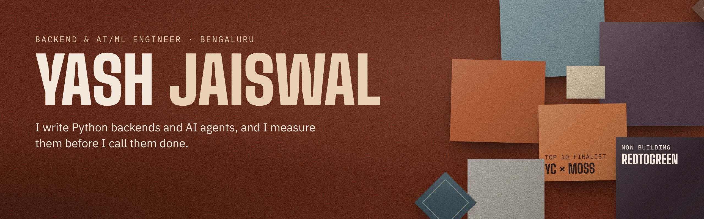

  
  
  

Final-year **AI & ML** student at CMR Institute of Technology, Bengaluru, graduating in 2027.
I build Python backends and AI agents, and I benchmark them before I call them done.
Open to **Software Engineer** and **AI/ML Engineer** roles and internships.

### Projects

| Project | What it does | Built with |
|---|---|---|
| [**RedToGreen**](https://github.com/its-yashjai/RedToGreen) | An AI agent that reads a failing CI build, writes a fix and reruns the tests in a sandbox until the build passes. *In progress.* | Python · LLM agent · GitHub webhooks · Caddy |
| [**Document Intelligence**](https://github.com/its-yashjai/grounded-rag-bot) | RAG platform that answers questions from your own documents and shows the passages it used. 40+ REST APIs, under 200 ms per query. | Django · FastAPI · LangGraph · Groq · ChromaDB |
| [**URL Shortener**](https://github.com/its-yashjai/URLshortner) · [live](https://url-shortener-fufm.onrender.com) | Stateless shortener rewritten for speed: redirects 492 → 256 ms, throughput 203 → 424 req/s, tested with k6. | FastAPI · Redis · PostgreSQL · Docker |

### Highlights

- **Top 10 finalist** at YC Fall 2026 × Moss with [NeuralFlow](https://neuralflow-uorm.onrender.com/), and 7th for Best Storytelling Video, out of 350+ teams
- Built [**WorkFlowOS**](https://github.com/its-yashjai/WorkFlowOS) in a day at TechStackX (CMRIT × 7thGear)
- Co-authored an IEEE-style research paper on Physics-Informed Neural Networks for heat management
- Filed a design patent for an AI-powered pen

### Stack

  
  
  
  
  
  
  
  
  
  
  

